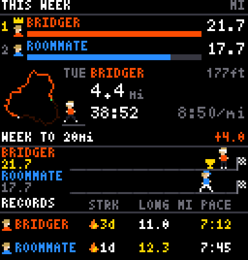

# Strava Running plugin for LEDMatrix

A [LEDMatrix](https://github.com/ChuckBuilds/LEDMatrix) plugin that turns your
RGB LED panel into a running scoreboard for a few Strava athletes (you and your
roommate, for example). Designed for 128x32; works on other sizes.



Four rotating views, each its own slot in the display rotation:

| Mode | What it shows |
|---|---|
| `strava_leaderboard` | Who ran the most this week (or any past week / month / year). Pages through the periods you configure. |
| `strava_runs` | One animated card per run in the period: the GPS route traces itself while a pixel-art runner jogs beside it, with distance, time, pace and elevation. The slot stretches to show every run. |
| `strava_race` | Head-to-head: each runner moves along a track toward a mileage goal. Shows the gap. |
| `strava_records` | Current run streak, longest run this month and fastest pace this week, per athlete. |

Every athlete shares the same runner character and gets their own shirt,
shorts and accessory (headband, cap or sunglasses).

## Install

1. In the LEDMatrix web UI (`http://<pi>:5000`) open **Plugins → Install from GitHub**.
2. Enter `https://github.com/bridgermiddleton/strava-plugin` and install.
3. Open the plugin's settings page, tick **Enabled**, and follow the Strava
   setup below.

## Strava API setup (once)

1. Go to <https://www.strava.com/settings/api> and create an application
   (any name, category *Visualizer*). Set **Authorization Callback Domain** to
   `localhost`. You only need the **Client ID** and **Client Secret**.
2. Paste both into the plugin settings and **save**.
3. Click **Connect Strava**. A link appears. Open it, log in, click
   **Authorize**. Your browser lands on `http://localhost/exchange_token?...`
   and the page fails to load. That is expected. Copy the **entire URL** from
   the address bar.
4. Paste it into the box the UI shows and click **Complete connection**. The
   result prints your Strava athlete ID.
5. In the **Athletes** table, add a row for yourself (name, colors, accessory).
   Put the printed ID in `strava_id`, or leave it blank if the name matches
   your Strava first name. Save.

Your runs appear after the next update (within the configured update interval,
default 10 minutes).

## Adding your roommate (or anyone else)

Strava puts every new API app in **Single Player Mode**: only the app owner
can authorize it. Two ways around that:

**Option A: raise your app's athlete limit.** On the Strava API settings page
you can request a bump to 10 athletes. Since June 2026 Strava requires a
Strava subscription for apps above one athlete, so check the current rules on
that page. Once allowed, the flow is the same as above, just done by the other
person: click **Connect Strava**, send them the link, they authorize on their
phone or laptop, they send you back the `http://localhost/exchange_token?...`
URL they landed on, and you paste it into step 2.

**Option B: they use their own free Strava app (no subscription needed).**
Your roommate creates their own API application at
<https://www.strava.com/settings/api> (callback domain `localhost`) and gives
you its Client ID and Secret. Then, on the Pi:

```bash
cd /path/to/LEDMatrix/plugin-repos/strava   # or wherever the plugin is installed
python3 authenticate_strava.py --client-id THEIR_ID --client-secret THEIR_SECRET
```

The script prints an authorization link. They open it, authorize, and send you
the `localhost/exchange_token?...` URL; paste it when prompted. Their tokens
are stored along with their app's credentials, so refreshes keep working.

Add a row for them in the **Athletes** table afterwards. Useful extras:

```bash
python3 authenticate_strava.py --list          # who is connected
python3 authenticate_strava.py --remove 12345  # disconnect an athlete id
```

Tokens live in `token.json` next to the plugin code (git-ignored, preserved
across plugin updates). Delete it to start over.

## Configuration

| Setting | Default | Notes |
|---|---|---|
| `display_duration` | 10 s | Per-view time. The Rotation & Durations page can override per mode. |
| `update_interval` | 600 s | Strava polling. Two athletes at 10 min use about 3% of the free rate limit. |
| `units` | `mi` | or `km` |
| `week_start` | `monday` | Strava's weekly totals also start Monday. |
| `sport_types` | Run, TrailRun, VirtualRun | Add `Walk`/`Hike` to count them. |
| `history_days` | 90 | Fetch window for streaks and records. Older leaderboard periods are fetched on demand. |
| `views.leaderboard.periods` | this week | Any list of `{period: week\|month\|year, offset: n}`; the slot pages through them. |
| `views.runs.seconds_per_run` / `max_seconds` | 6 / 60 | With Dynamic Duration on, the slot lasts `runs x seconds_per_run`, capped. |
| `views.race.goal` | 20 | Finish line in your units, for the `race.period` (week or month). |

Disabling a view removes its rotation slot after the display restarts.

## Developing without a Pi

```bash
python3 -m venv .venv && .venv/bin/pip install -r requirements.txt pytest
.venv/bin/python -m pytest test/
.venv/bin/python test/render_preview.py            # PNGs of every view in preview_out/
```

`test/fixtures/activities.json` is a synthetic week of runs for two athletes
(regenerate with `test/make_fixtures.py`). The LEDMatrix repo's
`scripts/check_plugin.py` safety harness and the emulator (`python3 run.py -e`)
also work with this plugin checked out under `plugin-repos/`.

## How it fits LEDMatrix

* `manager.py` – `StravaPlugin(BasePlugin)`: fetches in `update()`, renders in
  `display(display_mode=...)` on the high-FPS loop (throttled to ~15 fps),
  dynamic duration for the run cards.
* `strava_api.py` – OAuth refresh (Strava rotates refresh tokens), activity
  fetching, polyline decoding, token file handling.
* `strava_data.py` – periods, leaderboard, streaks, records. Pure functions.
* `strava_render.py` / `strava_sprites.py` – PIL frame renderers and the
  pixel-art runner.
* `authenticate_strava.py` – the web-UI OAuth action (`get_auth_url()` +
  stdin step 2) and the CLI.

Strava's API terms limit caching to 7 days and forbid feeding the data to AI
systems; this plugin only keeps a short-lived cache for display.

## License

MIT. Bitmap fonts in `assets/fonts` are public domain (misc-fixed) and MIT
(Tom Thumb); see `assets/fonts/LICENSE-misc-fixed.txt`.
